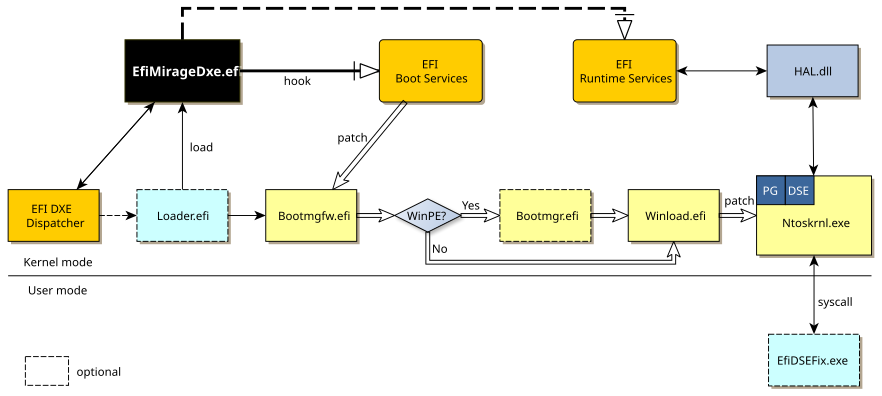

# Architecture and features

[Project overview](../README.md) · [Installation and usage](usage.md) · [Build guide](build.md)

EfiMirage inherits its boot-patching architecture from
[EfiGuard](https://github.com/Mattiwatti/EfiGuard).
The feature descriptions and history below are adapted from upstream. For this fork's
tested configurations, see the [validation status](build.md#validation-status).

## Features

- Currently supports all EFI-compatible versions of Windows x64 ever released, from Vista SP1 to
  Windows 11.
- Easy to use: can be booted from a USB stick or the Windows EFI partition via a loader that
  automatically finds and boots Windows. The driver can also be loaded and configured manually using
  either the UEFI shell or the loader.
- Makes extensive use of the [Zydis](https://github.com/zyantific/zydis) disassembler library for
  fast runtime instruction decoding to support more robust analysis than what is possible with
  signature matching, which often requires changes with new OS updates.
- Works passively: the driver does not load or start the Windows boot manager. Instead it acts on a
  load of `bootmgfw.efi` by the firmware boot manager via the boot selection menu or an EFI
  application such as the loader. If a non-Windows OS is booted, the driver unhooks its runtime
  services and its image is released, unless Secure Boot emulation is on (the default), in which
  case that hook stays for the booted OS too.
- Secure Boot state emulation, on by default: makes `SecureBoot` read as enabled and
  `SetupMode` as user mode to `winload`, the kernel and user mode,
  regardless of the firmware state. The firmware's own validation is untouched and TPM measurements
  still show the
  truth, so BitLocker PCR 7 sealing is unaffected in the other direction. See
  [Secure Boot emulation](secureboot.md).
- VBS and memory-integrity state emulation, off by default: patches the two kernel queries that
  report VBS/HVCI and the hypervisor query byte that changes with them, while VBS itself stays
  off so the memory-access interface keeps working. See [VBS emulation](vbs.md).
- Supports four-stage patching for when `bootmgfw.efi` starts `bootmgr.efi` rather than
  `winload.efi`. This is the case when a WIM file is loaded to boot WinPE, Windows Setup or Windows
  Recovery mode.
- Graceful recovery: in case of patch failure, the driver will display error information and prompt
  to continue booting or to reboot by pressing ESC. This is true even up to the final kernel patch
  stage, because the last patch stage happens before `ExitBootServices` is called. Many UEFI Windows
  bootkits hook `OslArchTransferToKernel` which, while easy to find by pattern matching, is a
  function that executes in protected mode after `ExitBootServices`. This means no boot services are
  available to tell the user that something went wrong.
  

  Simulated patch failure with error information
- Debuggable: can output messages to a kernel debugger and to the screen (albeit buffered) during
  the kernel patching stage, and to a serial port or unbuffered to the screen during the boot
  manager and boot loader patching stages. If the driver is compiled with PDB debug information, it
  is possible to load the debug symbols at any point after HAL initialization by specifying the
  virtual DXE driver base and debugging it as you would a regular NT driver.
- DSE bypasses: available as either a straightforward
  [UPGDSED](https://github.com/hfiref0x/UPGDSED)-style DSE disable at boot time or as a hook on the
  `SetVariable()` EFI runtime service. The latter serves as an arbitrary kernel mode read/write
  backdoor that can be called from Windows using `NtSetSystemEnvironmentValueEx` and allows setting
  `g_CiEnabled`/`g_CiOptions` to the desired value. A small DSEFix-style application named
  `EfiDSEFix.exe` is provided that can be used to do this. It is also possible to leave DSE enabled
  and to disable only PatchGuard. The loader will use the `SetVariable` hook method by default, due
  to the fact that some anti-cheat and anti-virus programs do not understand the difference between
  cheats or malware and self-signed drivers in general and target the UPGDSED fix.
- Supports on-disk modified kernels and boot loaders by patching `ImgpValidateImageHash` at every
  stage as well as `ImgpFilterValidationFailure`, which may silently rat out some classes of
  violations to a TPM or the SI log file.
- Allows Secure Boot to work with Windows 7 (not a joke!). Windows 7 itself is oblivious to Secure
  Boot as it does not support it, or (<a
  href="https://msdn.microsoft.com/en-us/ie/dn938339(v=vs.60)">officially</a>) even booting without
  CSM. This is useful for people who want to use Windows 7 on a locked down device that requires
  WHQL Secure Boot. The upstream EfiGuard wiki explains how to get this to work
  [here](https://github.com/Mattiwatti/EfiGuard/wiki/Secure-boot-on-Windows-7).
  

  [WinObjEx64](https://github.com/hfiref0x/WinObjEx64) on Windows 7 with Secure Boot enabled

## Boot flow and history

EfiMirage inherits its boot architecture from upstream EfiGuard. In the upstream
project's history, EfiGuard began as an on-disk NT patcher, similar to
[UPGDSED](https://github.com/hfiref0x/UPGDSED), to test disassembler-based analysis
instead of PDB symbols and version-specific signatures. Upstream later adopted UEFI
to improve capabilities and ease of use. [PatchNtoskrnl.c](../EfiMirageDxe/PatchNtoskrnl.c)
still reflects that original design.

Some of the benefits provided by a bootkit approach include:
- No on-disk modifications to kernels or bootloaders needed.
- No need to modify the boot configuration store using `bcdedit`.
- No need to patch `ImgpValidateImageHash` (although this is still optionally done).
- Ironically, the use of a bootkit allows enabling Secure Boot, provided you own the Platform Key
  and are able to add your personal certificate to the `db` store.

Upstream author Mattiwatti first adapted dude719's
[UEFI-Bootkit](https://github.com/ajkhoury/UEFI-Bootkit) for newer Windows 10 versions,
then rewrote EfiGuard to avoid the limitations of hooking `OslArchTransferToKernel`
after `ExitBootServices` and to support more Windows versions. The upstream design aims were:
- To provide patch information at every stage of boot including the kernel patch itself.
- To support all EFI-compatible versions of Windows versions (at the time of writing).
- To enable lazy instantiation of the bootkit and optionally a kernel backdoor, achieved by EFI
  System Table hooks.

A big picture overview of the final EfiMirage boot flow is shown in the diagram above. For the
individual component-specific hooks and patches, see `EfiMirageDxe/PatchXxx.c` in the source files.
For driver initialization/unloading and the EFI Boot and Runtime Services hooks, see
[EfiMirageDxe.c](../EfiMirageDxe/EfiMirageDxe.c).
